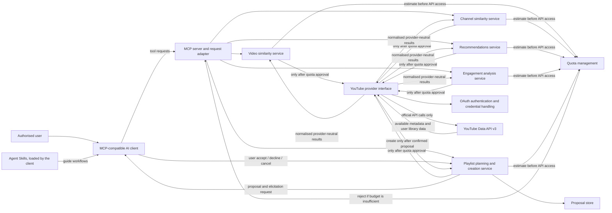

# Architecture overview

**Status:** Logical architecture only. No application code, language, framework or MCP SDK has
been chosen (`OD-01`). Decisions referenced here are **Proposed** ADRs unless stated otherwise.

The design follows the approved boundary: the MCP adapter routes requests to focused services;
services use an isolated YouTube provider; provider work must pass quota pre-checks. The YouTube
Data API v3 is the only YouTube data/operation source. No related-video, related-channel, or
watch-history endpoint is assumed.

## Components and interactions



The diagram shows responsibilities and required boundaries, not finalised class names or method
signatures. The draft data and provider contracts are in
[`docs/api/interfaces.md`](../api/interfaces.md) (`OD-17`). Quota figures are owned by
[SRS Appendix A](../srs.md#appendix-a--reference-youtube-api-quota); verify them against Google's
current documentation and the project's Quotas page before implementation.

## Module responsibilities

| Module | Responsibility and constraints | Proposed owner (unconfirmed) |
|---|---|---|
| MCP server | Register tools/resources and adapt protocol requests/responses; do not contain provider-specific API calls or core ranking logic. Detect the client's declared capabilities (for example `elicitation`) per request. | Person 3 |
| YouTube provider | The only module that calls the YouTube Data API v3. It **retrieves and normalises** metadata (videos, channels, playlists, subscriptions, liked videos) into the shared models, maps API errors to typed errors, and never ranks. Search calls and list pages count against their quota buckets. | Person 1 |
| Authentication | Desktop OAuth client with PKCE and loopback redirect for the local stdio deployment; `youtube.readonly` for reads and `youtube` requested incrementally for playlist creation; refresh token in the OS credential store; clear re-authorisation after the 7-day Testing-mode expiry or revocation ([ADR 0008](../adr/0008-oauth-client-and-scopes.md)). | Person 1 |
| Quota management | Estimate each planned provider operation from its documented method cost; track general units and every method-specific bucket separately, per Pacific-Time day, in a conservative local ledger. Include list pages and writes. Reject the complete workflow before its first API call if any bucket is insufficient or a cost is unknown. The ledger is an estimate, not Google's figure ([ADR 0006](../adr/0006-quota-reference-and-accounting.md)). | Person 1 |
| Video similarity | Rank normalised video metadata supplied by the provider; makes no provider calls. Weighted feature scores or TF-IDF with cosine similarity are candidates (`OD-07`). | Person 1 |
| Channel similarity | Rank normalised channel metadata supplied by the provider; makes no provider calls. | Person 2 |
| Recommendations | Use the authorised user's liked videos, subscriptions and playlists; never infer or claim watch-history access. | Person 2 |
| Engagement analysis | Compute channel/category, time, duration and period comparisons from the supported library sources (`OD-05`). | Person 2 |
| Playlist planning and creation | Validate topic, total duration, maximum video length and language constraints; create immutable proposals; create a playlist only through the two-phase confirmation in [ADR 0007](../adr/0007-playlist-confirmation.md); handle accounts without a channel. | Person 3 |
| Proposal store | Short-lived, per-account store of proposals (ID, canonical content, digest, expiry, state) with atomic state transitions; part of the playlist module. | Person 3 |
| Agent Skills | Instruction packages loaded by the AI client, not served by the MCP server (`NFR-09`). Skill instructions or tool output are never user confirmation. | Skill owners (`docs/development-plan.md`) |
| Video summary input | Open for `SK-05` (`OD-04`): metadata and/or a transcript supplied by the user. Do not scrape video pages or assume unofficial transcript APIs. | Person 2 + Person 3 |

*Change 2026-11-08 (audit N-2):* an earlier revision listed a separate "Metadata retrieval"
module that the diagram did not show and that overlapped with the provider. Retrieval and
normalisation are the provider's responsibility; services only rank or analyse. This matches the
processing steps of `FR-01`.

## Request boundaries

- Every service workflow that needs YouTube data checks its estimated quota before calling the
  provider. Insufficient budget, or an unknown operation cost, means no API request.
- Similarity uses project-computed metadata ranking, not an undocumented related-content
  endpoint. Search capacity is limited to about 50 search-dependent tool invocations per day per
  Cloud project under the `OD-09` proposal.
- Personalisation and analysis use only liked videos, subscriptions and playlists.
- A playlist write requires a user-mediated `accept` for one immutable, unexpired, unconsumed
  proposal. Model-generated arguments are never consent; clients without elicitation support get
  a typed error and an export for manual creation.
- Titles, descriptions, tags and other external metadata remain untrusted input.
- Ordinary CI uses mocks or recorded fixtures. Any live API tests are separate, scheduled,
  capped per run and fail closed (`NFR-08.3`, proposed `NFR-08.4`).

## Playlist confirmation flow

```mermaid
sequenceDiagram
    participant User
    participant Client as MCP client
    participant Server as MCP server (playlist module)
    participant YT as YouTube provider
    Client->>Server: tools/call propose_playlist(request)
    Server->>YT: reads (after quota pre-check)
    Server-->>Client: proposal + proposal_id + fingerprint (no writes)
    Client->>Server: tools/call create_playlist_from_proposal(proposal_id)
    Note over Server: verify ID, owner, state, expiry, digest; write quota pre-check
    Server-->>Client: InputRequiredResult (elicitation/create, URL mode preferred)
    Client->>User: show confirmation (clear decline/cancel)
    User-->>Client: accept
    Client->>Server: retried tools/call with the user's response
    Note over Server: atomic proposed -> creating (single use)
    Server->>YT: playlists.insert, then playlistItems.insert per video
    Server-->>Client: created playlist (or exact partial result)
```

## MCP protocol compatibility

- The Brain research targets MCP protocol `2026-07-28`, verified on 2026-11-08 as the current
  version. In that version every request carries its protocol version, servers must implement
  `server/discover`, and servers may support several versions; clients of the handshake-based
  revisions (`2025-11-25` and earlier) need the specification's backward-compatibility path.
- No SDK is chosen (`OD-01`) and no demo client is chosen (`OD-02`), so no compatibility has been
  tested. The supported transport and versions are decided in `OD-15`; the recommendation is
  local stdio, `2026-07-28`, plus `2025-11-25` if the chosen SDK supports both.
- Playlist creation additionally requires the client to support elicitation; older or limited
  clients can use every read feature but cannot create playlists (they receive the manual-creation
  export).

## Pending interfaces

The shared models and provider operations are drafted in
[`docs/api/interfaces.md`](../api/interfaces.md) and must be reviewed and frozen by all three
members (`OD-17`) before implementation. Language-specific signatures follow `OD-01`.

For CI and validator implementation evidence, see the Brain note
[CI Pipeline](../../brain/projects/CI-Pipeline.md).
