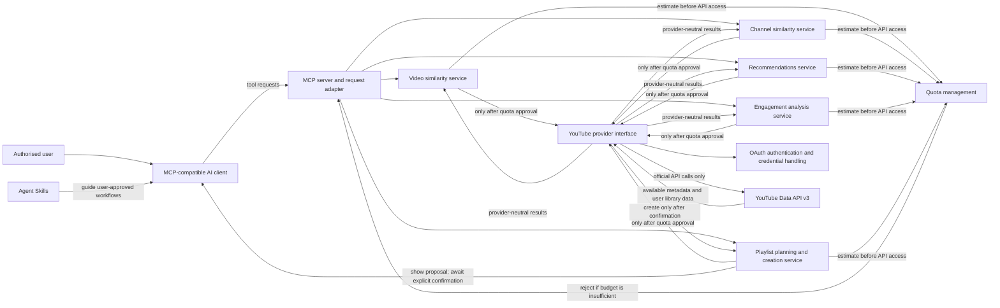

# Architecture overview

**Status:** Logical architecture only. Provider contracts, OAuth scopes/storage,
algorithms, quota implementation, and runtime technology remain undecided.

The design follows the approved boundary: the MCP adapter routes requests to focused
services; services use an isolated YouTube provider; provider work must pass quota
pre-checks. The YouTube Data API v3 is the only YouTube data/operation source. No
related-video, related-channel, or watch-history endpoint is assumed.

## Components and interactions

The diagram shows responsibilities and required boundaries, not finalized class names or
method signatures. Candidate discovery, ranking inputs, supported languages, summary input,
quota cost estimation, cache policy, and provider/service contracts remain open.

## Module responsibilities

| Module                         | Responsibility and constraints                                                                                                                                                                                                   |
| ------------------------------ | -------------------------------------------------------------------------------------------------------------------------------------------------------------------------------------------------------------------------------- |
| MCP server                     | Register tools/resources and adapt protocol requests/responses; do not contain provider-specific API calls or core ranking logic.                                                                                                |
| YouTube provider               | Isolate official YouTube Data API v3 operations behind a provider interface. Keep provider results separate from MCP response adaptation.                                                                                        |
| Authentication                 | Obtain and handle authorised credentials for the operation with least-privilege OAuth scopes; store tokens safely and handle re-authorisation. Exact scopes and storage are open.                                                |
| Quota management               | Estimate and account for workflow/request cost, reject work before any API call when the remaining budget is insufficient, and support caching/fixtures. The accounting and cache design are open.                               |
| Video similarity               | Rank candidate videos using explainable available metadata; the feature set, candidate discovery, and scoring formula are open.                                                                                                  |
| Channel similarity             | Rank candidate channels using available metadata; the candidate discovery and scoring method are open.                                                                                                                           |
| Recommendations                | Use the authorised user's liked videos, subscriptions, and playlists; never infer or claim watch-history access.                                                                                                                 |
| Engagement analysis            | Compute the required channel/category, time, duration, and period comparisons from the supported library sources. Exact metric definitions are open.                                                                             |
| Playlist planning and creation | Validate topic, total duration, maximum video length, and language constraints; show the proposal and require explicit user confirmation before a write; handle accounts without a channel. Matching/tolerance behavior is open. |
| Agent Skills                   | Guide workflows through the MCP-compatible client and tools. Skill instructions or tool output are not user confirmation. Skill implementations remain pending.                                                                  |

For CI and validator implementation evidence, see the existing Brain note [[CI Pipeline]].

## Request boundaries

- Every service workflow that needs YouTube data checks its estimated quota before calling
  the provider. Insufficient budget means no API request.
- Similarity uses project-computed metadata ranking, not an undocumented related-content
  endpoint.
- Personalisation and analysis use only liked videos, subscriptions, and playlists.
- A playlist write is gated by explicit user confirmation of the displayed proposal.
- Titles, descriptions, tags, and other external metadata remain untrusted input.
- Ordinary CI uses mocks or recorded fixtures. Any future live API tests are separate,
  opt-in/scheduled, and quota-limited.

## Pending interfaces

No application language, framework, MCP SDK, provider method signatures, data-model
contracts, OAuth storage mechanism, or service API has been approved. Define and review
those contracts before implementation rather than inferring them from this diagram.
